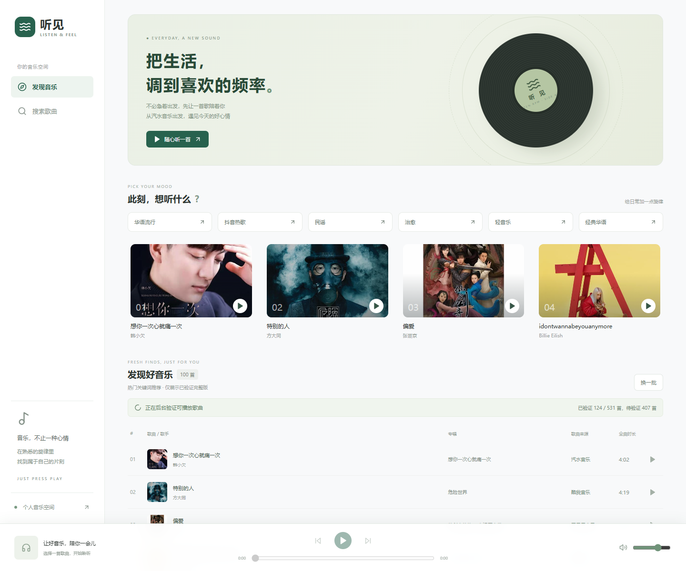

# 听见 · 个人在线音乐空间

**作者：DataShare**

一个基于 FastAPI、SQLite 和 Vue 3 的轻量音乐播放器，支持发现歌曲、多源搜索和在线播放

## 1、用户界面与使用



首次访问时，浏览器会要求输入配置的访问账号和密码，默认账号为 `music`

| 页面或区域 | 使用方法                                                                  |
| ---------- | ------------------------------------------------------------------------- |
| 发现音乐   | 随机展示最多 100 首已验证可播放的歌曲，点击“换一批”刷新推荐，点击歌曲播放 |
| 搜索歌曲   | 输入歌名或歌手，点击“搜索”或按回车，可切换汽水音乐、网易云音乐和酷我音乐  |
| 底部播放器 | 支持播放、暂停、上一首、下一首、进度拖动和音量调整，并显示实际播放来源    |

仅展示通过完整版验证的歌曲，当前不可用的歌曲会暂时隐藏，后续复检通过后自动恢复，首次启动请等待后台验证

服务繁忙时会限制搜索或播放连接，稍后重试即可，重复刷新和服务繁忙不会单独导致正常歌曲被隐藏

## 2、本地开发部署

需要 **Python 3.13、uv 和 Node.js 22.12+ / 24+**

先获取项目并安装后端依赖：

```powershell
git clone https://github.com/DataShare-duo/music.git
cd music
uv sync --locked
if (!(Test-Path .env)) { Copy-Item .env.example .env }
uv run python -c "import secrets; print(secrets.token_urlsafe(32))"
```

将生成的随机密码填入 `.env` 的 `MUSIC_ACCESS_PASSWORD`，密码需要 16～256 个字符，不配置密码时业务接口不可访问

终端一，在项目根目录启动后端：

```powershell
uv run uvicorn music.app:app --reload --host 127.0.0.1 --port 8000 --no-proxy-headers
```

终端二，启动前端：

```powershell
cd frontend
npm ci
npm run dev
```

先访问 `http://127.0.0.1:5173/api/sources` 完成浏览器认证，再访问 `http://127.0.0.1:5173`

后续启动只需运行对应的启动命令，重新安装前端依赖前先停止正在运行的前端服务，不要将 `.env` 或数据库提交到 Git

---

仅供个人非商业使用，音乐适配依赖 [musicdl](https://github.com/CharlesPikachu/musicdl)，保留上游作者署名和 [许可证](THIRD_PARTY_LICENSE_MUSICDL.txt)，不绕过平台会员或访问限制
